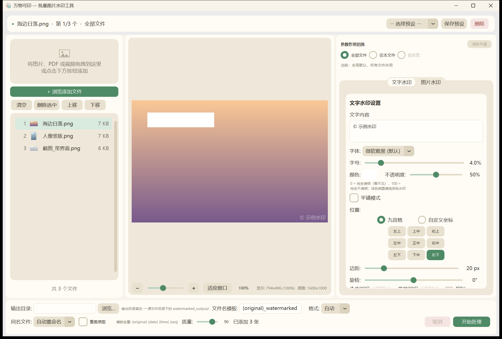

# 万物可印 · 批量图片水印工具

> **万物可印**（English: **Easy Batch Watermark**）—— 给每一张图片、每一份 PDF、每一条视频，盖上你的印记。基于 Python + Pillow + ffmpeg 的桌面端批量水印处理工具，面向图片、PDF 与视频的版权保护与品牌标识场景。开箱即用，支持拖拽导入、批量处理、实时预览，可一键打包为 Windows 可执行文件。无需联网，无需登录，素材导入导出均在设备本地进行，保障个人隐私及数据安全。

## 界面预览



界面为固定浅色皮肤（暖奶白底色 + 鼠尾草绿主色），上图为实际界面。

<!--
重新截图的步骤：
1. 运行 `python main.py` 启动程序
2. 拖入一张测试图，设置水印参数做演示
3. 用截图工具截取界面，保存为 `assets/screenshot.png`
4. 或使用脚本 `.workbuddy/scripts/ui_shot.py`（会自动喂示例图并截窗口本身；第二个参数可选 text|image）
-->

---

## 目录

- [功能亮点](#功能亮点)
- [支持格式](#支持格式)
- [快速开始](#快速开始)
- [从源码运行](#从源码运行)
- [打包为可执行文件](#打包为可执行文件)
- [命令行用法](#命令行用法)
- [配置参数详解](#配置参数详解)
- [预设系统](#预设系统)
- [技术设计](#技术设计)
- [项目结构](#项目结构)
- [常见问题](#常见问题)
- [许可证](#许可证)

---

## 功能亮点

### 1. 双水印模式，可叠加

支持**文字水印**与**图片 / Logo 水印**两种模式，可单独使用，也可同时叠加（先文字后图片）。

实际生效的类型由**内容**推导，而不是由「当前打开的是哪个 Tab」决定：

| 条件 | 实际类型 |
|------|----------|
| 文字非空 **且** 有 Logo | `both` |
| 只有 Logo | `image` |
| 其余 | `text` |

两个面板的参数会**合并成一份完整配置**提交，切换 Tab 只影响你正在编辑哪一组参数，不会把另一组静默关掉。所以「在文字 Tab 里调字号」不会丢掉已经选好的 Logo。

### 2. 文字水印完整参数

| 参数 | 说明 |
|------|------|
| 文本内容 | 支持多行（`\n` 换行） |
| 字体 | 自动探测系统字体，支持手动指定 |
| 字号 | 按图片短边的百分比自适应（1%–20%） |
| 颜色 | RGBA 四通道（颜色选择器取色） |
| 不透明度 | 0–100（0 = 完全看不见，100 = 完全不透明） |
| 位置 | 九宫格预设 或 自定义坐标百分比 |
| 旋转 | -180° ~ 180° |
| 平铺 | 整图平铺，支持行间错位；间距按「看得见的边缘」计算 |
| 边距 | 像素级边距 |

### 3. 图片 / Logo 水印

| 参数 | 说明 |
|------|------|
| Logo 来源 | 本地图片文件 |
| 缩放 | 按底图宽度比例（1%–50%），以 Logo 实际可见内容为准（自动裁掉透明留白） |
| 不透明度 | 0–100 |
| 旋转 | -180° ~ 180° |
| 平铺 | 支持整图平铺与交错排列 |
| 位置 | 九宫格 或 自定义坐标 |

### 4. 实时预览（真·所见即所得）

所有参数调整即时反映在预览区，无需反复试错。

**预览不是「大致像」，而是与导出严格同构**：同一套参数、同一套几何算法，只是在缩小的底图上渲染。这是靠把「绝对像素量」一起按比例换算做到的 ——

| 参数类别 | 字段 | 缩放行为 |
|----------|------|----------|
| 相对量 | 字号占比 `font_ratio`、Logo 占比 `scale_ratio` | 天然等比，任何分辨率都一致 |
| **绝对像素量** | 间距 `spacing_x/y`、边距 `margin`、`logo_margin`、`logo_spacing_x/y` | 按 `scale = 预览分辨率 / 导出分辨率` **同步换算** |

引擎的 `apply_watermark(img, cfg, scale=1.0)` 多了一个 `scale` 参数：`scale=1.0` 就是导出（行为与历史版本逐字节一致），预览传小于 1 的值。

字号与 Logo 的**下限也一起缩放**（`font_size = max(12*scale, 短边*font_ratio)`），否则小图上预览字号会被 12px 下限顶住，比导出的相对字号大出好几倍。

导出的「参考分辨率」只有一处来源：图片是原图像素，PDF 是页面可视尺寸 × `OVERLAY_SCALE`，由 `pdf_engine.overlay_reference_size()` 统一给出，避免覆盖层生成与预览两处算法各写一遍而逐渐漂移。

拖入 PDF 时预览区底部会出现**翻页栏**（上一页 / 下一页 / 跳转），可逐页检查水印效果；每页按自身页面尺寸渲染，混合尺寸或带 `/Rotate` 的页面都能正确显示。

**流畅度**：三类重复劳动各自带缓存 —— 解码后的底图按 `(路径, 页, 目标尺寸)` 缓存、渲染结果只在参数变化时重做、显示图按 `(画布尺寸, 缩放, 渲染版本)` 缓存。缩放与拖动只重采样已渲染好的图，不再重跑引擎；渲染走后台线程且做了**单飞合并**（渲染进行中只登记待办标记，不堆线程）。

#### 在预览图上直接拖水印

水印位置不必只靠数字调：**按在水印上拖动即可定位**。

- 鼠标移到水印上会变手型；按住拖动，水印跟着走，旁边实时显示百分比坐标
- 松手即写回「自定义坐标」（自动从九宫格切过来），并沿用当前**作用范围** —— 拖一次只影响当前这一层（全部文件 / 本文件 / 本页），与手输坐标完全等价
- 精度到 **0.01%**（3000px 宽的图上约 0.3px，比引擎自身 1px 的取整还细）
- 靠近 **0% / 50% / 100%** 自动吸附并显示对齐参考线，**按住 Alt** 可临时关闭吸附
- 按在水印以外的地方拖动仍是平移画面（原有操作不变）
- **平铺模式不支持拖动**：平铺的花纹从左上角按间距铺开，位置参数不参与定位（预览底部会给出提示）
- 拖动期间**不重渲染**：按下时备好「无水印底图 + 水印精灵」两张显示图，拖动中只移动画布项，松手后才走一次正常渲染 —— 所以是丝滑的，且最终结果仍由引擎产出

命中判定与坐标换算复用引擎里的 `watermark_boxes()` / `custom_percent_for_anchor()`，与真正渲染用的是同一组函数 —— **拖到哪就导出到哪是结构性保证**，而不是靠两处代码各自保持同步。

### 5. 批量处理、输出设置与拖拽导入

- 支持文件拖拽导入与文件对话框两种方式；自动去重、格式过滤
- **文件名模板**：支持 `{original}`、`{date}`、`{time}`、`{seq}`；清空或全是空格时自动回落默认模板，不会把整批文件写成同一个名字
- **同名冲突策略**：自动重命名（默认，绝不覆盖已有文件）/ 覆盖同名文件 / 跳过并计数
- **覆盖原图**：就地写回源文件，不可逆。触发前需要**两次确认**，第二次会明确提示"没有备份"
- 逐文件写出采用「临时文件写完 → 原子替换」，中途取消或出错不会留下半个文件
- 并行度按**解码后的像素内存预算**自动决定，而不是按压缩文件大小（见下文「内存与并发」）

#### 输出目录怎么定

输出位置完全由 `src/file_manager.resolve_output_target()` 决定，界面提示与执行同源，不会出现"提示说 A、实际写 B"：

| 情况 | 输出位置 |
|------|----------|
| 指定了输出目录 | 全部写到该目录 |
| 留空 + 单个来源目录 | 该目录下的 `watermarked_output/` |
| 留空 + 多个来源目录 | **各来源目录下各自建 `watermarked_output/`** |
| 留空 + 多个来源目录 + 合并为单个 PDF | 桌面「水印输出」（单文件必须有唯一落点，界面会提示） |

### 6. 预设系统

水印配置可保存为 JSON 预设，支持版本迁移与 Logo 路径失效容错，常用参数一键复用。

### 7. PDF 文件水印

除图片外，同样支持给 **PDF 逐页加水印**。

| 参数 | 说明 |
|------|------|
| 处理方式 | 覆盖层合并（**非**把页面转成图片），原文内容保留、文字仍可选可搜 |
| 参数复用 | 文字 / Logo 的全部参数与图片完全一致，预览所见即所得 |
| 页数显示 | 预览区显示总页数与当前页尺寸，可上一页 / 下一页 / 跳到第 N 页逐页检查 |
| 尺寸适配 | 按各页原始页面尺寸生成覆盖层，混合页面尺寸的 PDF 同样正确 |
| 旋转页 | `/Rotate 90/180/270` 的页面按显示方向渲染并反向写回，水印不被拉伸 |
| 输出格式 | 强制输出为 `.pdf` |

### 8. 视频文件水印

除图片与 PDF 外，也支持给 **视频加水印**，参数与图片完全共用。

| 参数 | 说明 |
|------|------|
| 处理方式 | 用 Pillow 引擎生成一张**全尺寸透明覆盖层**，再由 ffmpeg 叠加到每一帧 —— 位置、平铺、旋转、透明度、字号占比与图片走同一套代码 |
| 画质 | 默认 CRF 16 + preset slow（视觉无损档），不加水印以外的任何缩放滤镜 |
| 位深 | 10bit 源输出 10bit，不降 8bit（否则渐变处必出色带） |
| HDR | HLG / PQ 源自动走 10bit HEVC 并保留 `bt2020` / 色彩传输特性，不会发灰 |
| 竖拍视频 | 按显示方向转正后处理，水印不会转到画面外 |
| 音轨 | `copy` 原样直通（源编码 mp4 装不下时才转 AAC 256k） |
| 输出编码 | 可选「转 MP4」（兼容优先）或「保持原编码」（编回源编码器，适合回流剪辑） |
| 预览 | 抽首帧作底图，预览图上直接拖水印同样有效 |
| 限制 | 不支持就地覆盖原文件，不参与合并 PDF |

实测：1080p 6 秒素材 CRF 16 纯重编码 SSIM **0.999**，含水印成片 SSIM 0.992（差异全部来自水印本身）。

### 9. 输入值安全校验

所有数值输入（坐标百分比、间距、透明度、缩放、旋转角度）在进入引擎前统一校验：越界值自动夹取到合法区间、非法值回退默认值，并在状态栏提示修正结果，不会静默产生错误水印。

### 10. 参数作用范围：不同文件、不同页可以用不同参数

右侧面板顶部选择当前这套参数记到哪一层：

| 作用范围 | 含义 |
|----------|------|
| 全部文件 | 作为**全局默认**，没单独设置过的文件/页都用它 |
| 仅本文件 | 只记给列表里选中的这个文件（列表行亮起「专属」） |
| 仅本页 | 只记给 PDF 当前预览页（翻页栏显示「专属页: 2, 5」） |

导出时按 **页 > 文件 > 全局** 逐层查找：

- **只记改动过的字段**：单独设置某文件后，没改过的字段仍跟随全局默认变化，不会被旧值冻住
- **自动定位**：选中带专属参数的文件/页时，作用范围自动跳到那一层，面板显示的就是该文件真正会用的参数
- **手动切回「全部文件」**编辑全局默认时，提示行会写明「本文件已有专属参数，当前修改不影响它」，避免误以为改了个寂寞
- 「清除专属」删除当前层的专属参数，该文件/页回落到上一层

### 11. 输出为 PDF

输出格式下拉新增 **PDF**：

| 选项 | 行为 |
|------|------|
| PDF（不勾选合并） | 每个输入产出一个 PDF：图片 → 单页 PDF（页面尺寸 = 像素 × 72/96，与图片同比例、不留白边）；PDF → 逐页加水印后输出 |
| PDF + 勾选「合并为单个 PDF」 | 整批按列表顺序合成**一个多页 PDF**（一图一页），默认文件名形如 `合并水印_20261012_174500.pdf`；中途取消不会留下半成品文件 |

每个输入都用**它自己那一层**的参数（文件层 / 页层），所以「A 打红字、B 打蓝字、C 的第 1 页不打」在合并输出里同样成立。

图片放进 PDF 时的编码按**是否存在真实透明像素**选择：有透明像素走无损 PNG（保住 alpha），完全不透明走 JPEG 并应用底部栏的质量设置。
注意判断依据是"真的有透明像素"而不是"有 alpha 通道" —— 加过水印的图片一律是 RGBA，只看通道会让质量设置彻底失效、体积还大得多。

---

## 支持格式

| 类型 | 输入扩展名 | 输出 |
|------|-----------|------|
| 图片 | `.jpg` `.jpeg` `.png` `.bmp` `.webp` `.tiff` `.tif` | 同输入格式，并支持 `auto` / `png` / `jpeg` / `pdf` 格式转换 |
| PDF | `.pdf` | 固定输出 `.pdf`（逐页叠加水印） |
| 视频 | `.mp4` `.m4v` `.mov` `.mkv` `.avi` `.webm` `.flv` `.wmv` `.mpg` `.mpeg` `.ts` `.m2ts` | `.mp4`（默认）或源容器；编码可选 H.264 / 源编码器 |

三种源可混合拖入同一批次，各自按对应引擎处理；选择 `PDF` 输出时图片与 PDF 都可产出 PDF，也可整批合并成一个多页 PDF（含视频时合并自动停用）。

视频功能依赖随包分发的 ffmpeg（`_internal/ffmpeg/`），不需要用户自行安装。

---

## 快速开始

### 方式一：使用打包好的 exe（推荐普通用户）

1. 从 [Releases](https://github.com/MilanDeShallow/Batch-Image-Watermarking-Tool/releases/latest) 下载 `WatermarkTool-vX.Y.zip` 并解压。
2. 运行 `批量图片水印工具.exe`（或在项目根目录双击 `打开水印工具.bat`）。
3. 拖入图片或 PDF，点击「添加文件」即可开始。

无需安装 Python 或任何依赖。解压后请保持 `WatermarkTool` 文件夹完整 —— exe 与同目录的 `_internal` 是一体的，单独把 exe 拷出来无法运行。

### 方式二：从源码运行

见下节。

---

## 从源码运行

### 环境要求

- Windows 10 / 11（已测试）
- Python 3.10 及以上

  - **3.10 是硬下限**，依据是依赖而非我们的偏好：绑定约束来自 `pillow==12.3.0` 的
    `Requires-Python >=3.10`（其余依赖更低：reportlab ≥3.9、pyinstaller ≥3.8、customtkinter ≥3.7）
  - 全部源码用 3.10 解释器做过 `compileall` 校验，且未使用 3.11+ 专有特性
  - CI 在 **3.10 与 3.14** 双版本上跑（见下文「运行测试」）：3.10 验下限，3.14 是发布产物实际构建所用的版本

### 安装依赖

```bash
cd watermark_tool
pip install -r requirements.txt
```

依赖清单（与 `requirements.txt` 逐行一致 —— **请以文件为准**，本项目的依赖一律**固定版本**而非区间：
同一套参数在不同 Pillow 大版本下可能产出不同字节，出问题时要能精确复现）：

```
pillow==12.3.0
customtkinter==6.0.0
tkinterdnd2==0.6.2

# PDF 功能（仅做图片水印时可不装）
reportlab==5.0.1
pypdf==6.16.2
pypdfium2==5.13.0

# 内存预算与进度显示：拿不到时程序会回落到保守值，不会崩
psutil>=5.9.0

# 仅打包时需要
pyinstaller==6.21.0
```

> `pyinstaller` 仅打包时需要，运行时可省略。
> `reportlab` / `pypdf` / `pypdfium2` 仅为 PDF 功能所需；若只用图片水印，可不安装。
> `psutil` 未装时程序仍可运行，但并行度会按 2GB 兜底预算估算（见下文「内存与并发」）。

已验证版本组合：Pillow 12.3.0、customtkinter 6.0.0、tkinterdnd2 0.6.2、reportlab 5.0.1、pypdf 6.16.2、pypdfium2 5.13.0、PyInstaller 6.21.0。

这套版本在 **Python 3.10 与 3.14** 上都跑通了完整测试；发布用的 exe 由 **3.14** 构建。

### 启动

```bash
python main.py
```

或双击仓库中的 `启动水印工具.bat`。

---

## 打包为可执行文件

项目内置 PyInstaller 打包脚本，一键生成免环境运行的 exe。

### 一键打包

```bash
build_exe.bat
```

脚本会自动完成依赖检查、清理旧构建、打包、验证输出。

### 手动打包

```bash
python -m PyInstaller build.spec --noconfirm
```

### 输出

- 输出目录：`dist/WatermarkTool/`
- 主程序：`dist/WatermarkTool/批量图片水印工具.exe`
- 将整个 `WatermarkTool` 文件夹分发给用户即可

`build.spec` 已处理 CustomTkinter、tkinterdnd2 的数据文件收集，以及 PDF 所需的 `pypdfium2` 原生 DLL（`collect_dynamic_libs`）与 `reportlab` / `pypdf` 隐式导入，无需额外配置。预设**不**进安装目录：运行时统一读写 `%APPDATA%/WatermarkTool/presets`，所以 spec 里刻意没有收集 `presets/`（安装目录是只读的）。

---

## 命令行用法

水印引擎（`watermark_engine.py`）与 GUI 解耦，可独立用于脚本化处理：

```bash
python -m src.watermark_engine <输入图片> <输出图片>
```

示例：

```bash
python -m src.watermark_engine photo.jpg output.jpg
```

默认会叠加「内部资料 / Confidential」平铺文字水印，便于快速验证引擎可用性。如需自定义参数，可在脚本中构造 `WatermarkConfig` 并调用 `apply_watermark()`。

### 核心引擎 API

```python
from src.config import WatermarkConfig
from src.watermark_engine import safe_open_image, apply_watermark, save_with_format

cfg = WatermarkConfig(
    watermark_type="both",       # "text" | "image" | "both"
    text="© 品牌方",
    color_rgba=(255, 255, 255, 128),
    opacity=50,
    font_ratio=0.04,
    angle=30,
    tile=True,
    spacing_x=150,
    spacing_y=150,
    stagger=True,
    logo_path="logo.png",
    scale_ratio=0.10,
    logo_opacity=80,
)

img = safe_open_image("input.jpg")
result = apply_watermark(img, cfg)
save_with_format(result, "output.jpg", jpeg_quality=90)
```

### PDF 引擎 API

PDF 使用独立入口 `apply_pdf_watermark()`，参数复用同一个 `WatermarkConfig`：

```python
from src.config import WatermarkConfig
from src.pdf_engine import apply_pdf_watermark, render_pdf_page, get_pdf_page_count

cfg = WatermarkConfig(
    watermark_type="text",
    text="内部资料",
    angle=30,
    tile=True,
    spacing_x=200,
    spacing_y=200,
)

pages = apply_pdf_watermark("input.pdf", cfg, "output.pdf")   # 返回处理页数
print(f"已处理 {pages} 页")

first_page = render_pdf_page("input.pdf", page_num=0, scale=2.0)   # 返回 PIL.Image
print(get_pdf_page_count("input.pdf"))

# 覆盖层渲染倍率（默认 2.0 ≈ 144 DPI）。调低换体积，调高换清晰度。
# 提高倍率会让内存与输出体积同步上升，因为覆盖层是整页位图。
# 注意：批处理会在开始时取一次快照并贯穿该批 —— 处理途中调它只影响下一批，
# 否则同一份 PDF 的前后几页会按不同参考尺寸渲染，同一文件里出现两种水印大小。
from src.pdf_engine import set_overlay_scale, get_overlay_scale
set_overlay_scale(1.5)

# 数字签名检测：加水印必然让签名失效，处理前应当告知用户
from src.pdf_engine import has_digital_signature, signed_pdf_files
signed_pdf_files(["a.pdf", "b.pdf"])   # 从列表里挑出带签名的
has_digital_signature("a.pdf")         # bool
```

`apply_pdf_watermark()` 对加密 PDF 会抛 `ValueError`；若 PDF 可用空密码解锁，则自动解密后处理。

**逐页不同参数**：传 `page_configs={页码: WatermarkConfig}` 只对指定页使用另一套参数（页码 0 起，未列出的页仍用 `cfg`）：

```python
base = WatermarkConfig(text="内部资料", opacity=40)
page_cfgs = {1: WatermarkConfig(text="样片", color_rgba=(255, 0, 0, 255), opacity=100)}

apply_pdf_watermark("input.pdf", base, "output.pdf", page_configs=page_cfgs)
```

**图片 → PDF 与多合一**：

```python
from src.pdf_engine import build_merged_pdf, image_file_to_pdf_bytes

data = image_file_to_pdf_bytes("photo.jpg", cfg, jpeg_quality=90)   # 单张图片 → 单页 PDF 字节

# 多输入合并为一个多页 PDF（图片一图一页，PDF 逐页并入，顺序即页序）
pages = build_merged_pdf(
    [
        {"path": "photo.jpg", "config": cfg},
        {"path": "report.pdf", "config": cfg, "page_configs": {0: cfg}},
    ],
    "merged.pdf",
    jpeg_quality=90,
)
```

`build_merged_pdf()` 支持 `progress(index, total, filename)` 与 `should_cancel()` 回调；
取消时抛 `MergeCancelled`，且**不会写出任何文件**（避免留下半成品）。

### 参数作用域 API

`src/overrides.py` 提供三层参数存储（无 GUI 依赖，GUI 与脚本共用同一套语义）：

```python
from src.overrides import ScopeStore

store = ScopeStore()
store.update_base({"text": "内部资料", "opacity": 50})   # 全局默认
store.update_file("B.jpg", {"text": "样片"})             # B 的专属参数
store.update_page("C.pdf", 2, {"opacity": 100})          # C 第 3 页的专属参数

store.config_for("C.pdf", 2).text      # '内部资料' —— 页层没设 text，逐层继承
store.config_for("C.pdf", 2).opacity   # 100        —— 被页层覆盖
store.marker_text("C.pdf")             # '专属 第3页'
```

面板提交的是**完整参数**而不是小补丁，这种场景用 `set_file` / `set_page`：
它们会自动与父层做差，只把真正不同的字段记下来。

```python
store.set_base({"text": "内部资料", "opacity": 50, "margin": 20})
# 面板提交了一整份参数，其中只有 text 与全局不同
store.set_file("B.jpg", {"text": "样片", "opacity": 50, "margin": 20})

store.to_dict()["files"]["B.jpg"]   # {'text': '样片'} —— 只存了差异

store.update_base({"opacity": 30})  # 之后再修改全局默认
store.config_for("B.jpg").opacity   # 30 —— 没动过的字段跟着变，没被旧快照冻住
```

每层只保存**改动过的字段**，未改动的字段继续向上继承；输出类字段（输出目录、格式、质量、文件名模板）不进入作用域。

`update_file` / `update_page` 保留为「按字段合并」语义，适合脚本里手写小补丁的场景。

### 批处理 API

`src/batch_planner.py` 把「文件列表 + 作用域参数 + 输出设置」翻译成可执行的任务清单，
不含任何 GUI 代码，因此导出方案可以被测试直接覆盖：

```python
from src.batch_planner import plan_batch, plan_output_paths, execute_task

plan = plan_batch(files, store, out_format="PDF", merge_pdf=True)
plan.out_format        # 'pdf'
plan.merge             # True
plan.tasks[1].config   # 该文件真正生效的 WatermarkConfig
plan.tasks[2].page_configs   # {页码: WatermarkConfig}，只含被单独设置过的页

# 一次性把「文件名模板 + 同名冲突策略 + 覆盖原图」算成落点。
# 返回 (每个任务的输出路径, 合并输出路径)；路径为 None = 该文件按策略被跳过。
output_paths, merged_path = plan_output_paths(
    plan, output_dir,
    filename_template="{original}_wm",
    on_conflict="rename",          # "rename" | "overwrite" | "skip"
    overwrite_original=False,
)

for task, out_path in zip(plan.tasks, output_paths):
    if out_path is None:
        continue                   # 冲突策略判定为「跳过」
    execute_task(task, out_path, jpeg_quality=90,
                 should_cancel=lambda: cancelled,   # 文件入口 + PDF 每页之间都会查
                 overlay_scale=snapshot)            # 本批固定倍率

from src.pdf_engine import build_merged_pdf
build_merged_pdf(plan.merge_items(), merged_path, jpeg_quality=90,
                 overlay_scale=snapshot)
```

几点约定：

- `execute_task()` / `build_merged_pdf()` 的 `should_cancel` 返回真时，分别抛 `TaskCancelled` / `MergeCancelled`。取消**不算失败** —— 原子写出保证不留下半成品
- 所有输出路径都走原子写出（临时文件 → `os.replace()`），异常或中断时旧文件原封不动
- `plan_output_paths()` 内部维护「本批已占用名字」集合，所以即使选「覆盖同名文件」，同一批里的两个文件也不会互相盖掉
- `file_manager.generate_output_path()` 在冲突策略为「跳过」时返回 `None`（不是空字符串），调用方必须先判空
- `overlay_scale` 是覆盖层渲染倍率快照：批处理入口取一次并贯穿整批，否则处理途中调倍率会让同一份 PDF 的前后几页尺寸不一致。不传则由 `pdf_engine` 取当时的全局值 —— 预览走的正是这条路，因为拖动滑块时预览应当立即跟着变

`plan_batch` 的两条内置规则：PDF 源文件无论输出格式选什么都强制输出 PDF；`merge` 只在输出格式为 PDF 且显式勾选时才为真。

---

## 配置参数详解

`WatermarkConfig` 是 GUI 与引擎之间的单一数据契约，完整字段如下。

### 水印类型

| 字段 | 默认值 | 说明 |
|------|--------|------|
| `watermark_type` | `text` | `text` / `image` / `both` |

### 文字水印

| 字段 | 默认值 | 说明 |
|------|--------|------|
| `text` | `""` | 水印文字，支持 `\n` 多行 |
| `font_path` | `""` | 空=自动探测系统字体 |
| `font_ratio` | `0.04` | 字号相对图片短边百分比 |
| `color_rgba` | `(255,255,255,128)` | 文字颜色。**只有前三位 RGB 是输入**，第 4 位由 `opacity` 派生 |
| `opacity` | `None` | 不透明度 0–100，**唯一权威来源**。留 `None` 表示未指定，此时从 `color_rgba` 第 4 位推断（兼容旧写法） |
| `position` | `bottom-right` | 九宫格位置 |
| `position_mode` | `grid` | `grid` / `custom` |
| `custom_x` / `custom_y` | `50` / `50` | 自定义位置百分比 |
| `margin` | `20` | 边距 px |
| `angle` | `0.0` | 旋转角度 |
| `tile` | `False` | 是否平铺 |
| `spacing_x` / `spacing_y` | `100` / `100` | 平铺间距，按可见边缘计算 |
| `stagger` | `False` | 平铺行间错位 |

### 图片水印

| 字段 | 默认值 | 说明 |
|------|--------|------|
| `logo_path` | `""` | Logo 文件路径 |
| `scale_ratio` | `0.10` | Logo 相对底图宽度比例（以可见内容为准，自动裁掉透明留白） |
| `logo_opacity` | `50` | Logo 不透明度 0–100 |
| `logo_tile` | `False` | Logo 平铺 |
| `logo_spacing_x` / `logo_spacing_y` | `100` / `100` | 平铺间距，按可见边缘计算 |
| `logo_stagger` | `False` | Logo 平铺行间错位 |
| `logo_angle` | `0.0` | Logo 旋转 |
| `logo_position` | `bottom-right` | 九宫格位置 |
| `logo_position_mode` | `grid` | `grid` / `custom` |
| `logo_custom_x` / `logo_custom_y` | `50` / `50` | 自定义位置百分比 |
| `logo_margin` | `20` | 边距 |

### 输出

| 字段 | 默认值 | 说明 |
|------|--------|------|
| `output_dir` | `""` | 空=按源文件所在目录分别输出（见上文「输出目录怎么定」） |
| `output_format` | `auto` | `auto` / `png` / `jpeg` / `pdf` |
| `jpeg_quality` | `90` | JPEG 质量 60–100 |
| `filename_template` | `{original}_watermarked` | 文件名模板，支持 `{original}` / `{date}` / `{time}` / `{seq}` |
| `on_conflict` | `rename` | 同名输出文件怎么办：`rename`（自动重命名）/ `overwrite` / `skip` |
| `overwrite_original` | `False` | 就地写回源文件（不可逆，界面需两次确认） |

### 九宫格位置取值

格式为 `{vertical}-{horizontal}`，或直接使用 `center`。

- vertical：`top` / `middle` / `bottom`
- horizontal：`left` / `center` / `right`

示例：`top-left`、`middle-center`、`bottom-right`。

旧版本曾用 `center-left` / `center-right` 表示「左中 / 右中」。这两个写法**仍被接受**，
加载旧预设时会自动归一化为 `middle-left` / `middle-right`。原因：引擎的垂直分量只认
`top / middle / bottom`，`center` 落到垂直分量上会命中字典默认值，让水印悄悄跑到正中，
而且界面按钮高亮正常、不报任何错。

---

## 预设系统

预设存储为 JSON 文件，位于 **`%APPDATA%/WatermarkTool/presets/`**，每个预设一个文件。

为什么放在用户目录：PyInstaller 打包后 `__file__` 落在 `_internal/` 下，程序若装到
`Program Files`，那里是只读的 —— 用户一保存就报"保存预设失败"。界面布局与日志也都走
`APPDATA`，这里是同一套口径。

首次访问时会把旧版本留在项目 `presets/` 目录下的预设**复制**过来（是复制不是移动，
旧目录保持原样，用户可以随时退回旧版本；同名文件不覆盖，以用户目录里的那份为准）。

- **保存**：当前所有参数序列化为 `{预设名}.json`
- **加载**：反序列化时自动过滤未知字段、恢复 tuple 类型、按 `version` 字段做版本迁移
- **路径失效容错**：若预设绑定的 Logo 文件已不存在，自动清空 `logo_path` 并给出警告，不阻断流程
- **文件名安全化**：预设名中的非法字符自动替换为下划线

预设可直接通过 `PresetManager` 管理：

```python
from src.preset_manager import PresetManager
from src.config import WatermarkConfig

# 保存
PresetManager.save_preset("品牌水印", cfg)

# 加载
cfg, warnings = PresetManager.load_preset("品牌水印")

# 列出全部
names = PresetManager.list_presets()

# 删除
PresetManager.delete_preset("品牌水印")
```

---

## 技术设计

### 健壮性

1. **EXIF 方向自动校正**：调用 `ImageOps.exif_transpose()` 实际旋转像素，并清除 EXIF 中的 `Orientation` 标记为 `1`，防止支持 EXIF 的查看器对已旋转图片二次旋转。
2. **色彩空间归一化**：能直接进合成管线的模式原样保留（`RGB` / `RGBA` / `L`）；`LA` 与带 `transparency` 的调色板 PNG 一律转 `RGBA` —— 它们的模式名里不带 `A`，却确实携带透明通道，以前统一 `convert("RGB")` 会把透明区域变成实心（半透明 Logo 导出来是一块黑底方块，且没有任何报错）。16/32 位灰度与浮点模式无法在 8 位/通道的管线里保留位深，转换时**写一条日志**说明位深被压缩，不再无声降位。
3. **读取失败带文件名**：`Image.open` 与 `src.load()` 的异常统一包装成 `ValueError("无法读取图片 xxx：…")`。Pillow 原始抛出的 `Truncated File Read` 不带文件名，批量失败清单里只会留下一句无从下手的报错。
4. **超大图有安全上限**：`src/config.py` 里的 `MAX_IMAGE_PIXELS = 300_000_000`（约 3 亿像素，解码后约 1.2GB RGBA），渲染引擎与内存预算共用这一个值。旧实现把它设为 `None`，等于完全关掉 Pillow 的解压炸弹保护 —— 一张解压炸弹或超大 TIFF 就能把进程撑死。超限文件在批处理开始前被识别出来，**明确告知后跳过**，而不是交给 Pillow 去撞内存后崩掉。
5. **字体多级回退**：用户指定路径 → 微软雅黑 → 黑体 → Pillow 内置字体，任一可用即停止，避免缺字崩溃。
6. **空字符串容错**：文字为空或纯空白时直接返回原图，不报错。
7. **路径清洗**：自动清除 Windows 拖拽传入的 `{}` 包裹与引号。
8. **文件句柄释放**：所有图片读取路径使用 `with Image.open(...)` 并在加载后返回脱离文件的对象副本。若在打开与加载之间抛异常，句柄会被一直占用，导致源文件无法重命名 / 删除 —— 这在 Windows 上是常见故障。
9. **输入值统一校验**：`src/validators.py` 对所有数值输入做解析与区间夹取（坐标百分比 0–100、间距 ≥ 1、透明度 0–100、缩放 1%–100%、旋转 -180°–180°），非法值回退默认值并在状态栏提示。同时兜底平铺步长，避免间距为 0 或负数时 `range()` 抛异常或静默返回空序列。
10. **界面不会被自己的弹窗卡死**：完成提示框不再调用 `grab_set()`。

   根因值得记一笔：CustomTkinter 的 `CTkToplevel` 为了刷新标题栏颜色，构造时会先 `withdraw()` 自己、再 `after(5)` 调 `deiconify()`。在这个窗口上再叠加模态抓取，抓取就落在了一个「当时不可见」的窗口上。若主窗口此刻正好被最小化，子对话框会被连带置为 `withdrawn`，而输入抓取仍然攥在它手里 —— 表现就是**导出完把软件最小化后，再也点不醒**（实测 `grab_current` 始终指向那个 withdrawn 的对话框）。

   修法有两层：
   - 完成对话框改为「单例 + `lift()` + `bind("<Destroy>")` 清理」，不动系统的输入抓取
   - 兜底安全网 `_release_stale_grab()`：绑定 `<Map>` / `<FocusIn>`，一旦发现 `grab_current()` 存在但该窗口不可见，就主动释放

   第一层治本，第二层保证即使将来有人重新引入模态，界面也不会被锁死。
10. **原子写出**：逐文件输出先写同目录下的临时文件 `.{名字}.part{扩展名}`，成功后再 `os.replace()` 顶替目标；失败就删掉残留。临时名**必须保留扩展名**（`.png` / `.jpg` / `.pdf`），否则 Pillow 会选错编码器。勾了「覆盖原图」时这一层同时是源文件的保命索 —— 中途出错时旧文件原封不动。
11. **有界任务队列 + 任务内取消**：线程池只保持「并行度」个在飞任务，不再一次性提交整批。取消后立刻停止提交新任务，已启动的任务在可中断点（每个文件入口、PDF 每一页之间）退出。旧实现一次性提交全部任务，取消只是把还没轮到的那批标记掉，实际仍会逐个跑完 —— 大批量高分辨率图下会白烧几十分钟 CPU。
12. **内存预算决定并行度**：按「最坏单张解码后的峰值内存」反推能开几个线程。图片通过读文件头探测像素尺寸（不解码像素），PDF 通过读 media box 得到页面**显示**尺寸。详见下文「内存与并发」。
13. **失败清单落盘**：有失败时在输出目录写 `失败清单_YYYYMMDD_HHMMSS.txt`，完成对话框里提供「查看失败清单」按钮。打包后的 exe 没有控制台，状态栏那行字转眼被覆盖，没有这个文件用户无从回溯"哪几张错了、为什么"。

### PDF 水印实现原理

采用**覆盖层合并**方案，而非把 PDF 页面渲染成图片后再重新组卷 —— 后者会丢失文本可选中性与矢量清晰度。

```
Pillow 引擎在透明底图渲染水印 ──▶ 透明 PNG 覆盖层
        │
        ▼
reportlab 包成与页面同尺寸的覆盖 PDF
        │
        ▼
pypdf merge_page 逐页叠加到原 PDF（原内容保留）
```

- 覆盖层渲染倍率 `OVERLAY_SCALE = 2.0`（约 144 DPI），保证文字在 200% 缩放下依然清晰；批处理在开始时取一次快照，整批固定同一倍率
- 预览（`pypdfium2` 渲染当前页 + Pillow 叠加）与导出（透明底图 + 同一 Pillow 引擎）使用相同的相对几何计算，所见即所得
- 覆盖层按「页面尺寸 + 旋转角 + 倍率 + 配置指纹」缓存，多页同规格时只生成一次。缓存有上限（条数 + 总字节双约束，超出按 LRU 淘汰）：逐页设了不同参数的 PDF 会让每页指纹都不同，没有上限等于把整本的覆盖层位图都留在内存里，而那种情况下命中率本来就是 0
- `/Rotate` 页面按**显示方向**渲染覆盖层，再反向旋转同角度写入页面坐标系，与目标页的 `/Rotate` 合成后正好摆正。旧实现按未旋转 `mediabox` 创建覆盖层，90° 下横向 ×0.707、纵向 ×1.415，水印被拉伸约 2 倍

**元数据与数字签名**

| 项 | 行为 |
|----|------|
| 保留的元数据 | `/Title`、`/Author`、`/Subject`、`/Keywords`、`/Creator` 原样带到输出 |
| `/Producer` | 改写为本工具（毕竟确实动过这个文件），避免"署名还说没改过" |
| 数字签名 | 处理前用 `signed_pdf_files()` 检测（`/Root/Perms` 的 DocMDP / UR、AcroForm 里 `/FT = /Sig` 的签名字段、`/AcroForm/SigFlags`）。检测到会**明确弹窗告知签名必然失效**，由用户决定是否继续 —— 重新签名需要用户私钥，工具无法代劳 |

**已知限制与后续计划**

| 限制 | 说明 / 计划 |
|------|-------------|
| 覆盖层是整页位图 | A4 单页覆盖层约 1190×1684 RGBA，输出体积随页数线性上升；缓存已加上限（条数 + 字节双约束，LRU 淘汰），不会随页数无限增长。体积敏感时可用 `set_overlay_scale()` 调低倍率 |
| 加密 PDF | 仅支持空密码（自动解密）；有密码的 PDF 会明确报错 |
| 水印本身仍是位图 | 后续可升级为**矢量文字覆盖层**（在覆盖 PDF 里直接排文字而不是贴图），清晰度与体积都能显著改善；代价是要额外解决字体嵌入与中文子集化 |

页级参数已支持，见上文「参数作用范围」一节：`apply_pdf_watermark(..., page_configs={页码: WatermarkConfig})` 只对列出的页换参数，未列出的页仍用基准配置，并且只影响水印、不动原文。

### 智能保存

- **JPEG**：`RGBA→RGB`（白底合成）+ 安全 EXIF
- **PNG**：保持 `RGBA`
- **TIFF / WebP**：支持 EXIF 透传
- **其他**：直接保存
- 自动创建输出目录

### 内存与并发

并行度不看压缩文件大小，只看**解码后的像素**。原因是两者没有稳定关系：

| 文件 | 压缩后 | 解码后 RGBA |
|------|--------|-------------|
| 10000×7000 JPEG | 约 200 KB | 约 280 MB |
| 1920×1080 PNG | 约 5 MB | 约 8 MB |

按"文件 > 15MB 才限 2 线程"这类规则分档，会在高分辨率场景下开出过多线程，几张大图并发就能把内存吃光。

`src/resource_budget.py` 的规则：

| 项 | 值 | 说明 |
|----|----|------|
| `BYTES_PER_PIXEL` | 4 | RGBA |
| `TASK_SLACK` | 5.0 | 图片单任务峰值系数，等效 20 B/px（**实测** 16.2，见下） |
| `PDF_PAGE_SLACK` | 7.0 | PDF 单页峰值系数，等效 28 B/px（**实测** 21~23，见下） |
| `MEMORY_BUDGET_RATIO` | 0.5 | 最多用掉可用内存的一半 |
| `MAX_WORKERS` | 8 | 并行度上限 |
| `MAX_IMAGE_PIXELS` | 3 亿 | 超过即拒绝处理（Pillow 在 2× 阈值抛错，本工具捕获后转成带文件名的提示） |
| `LARGE_IMAGE_PIXELS` | 5000 万 | 超过即触发开始前的内存预警 |
| `PDF_SIZE_PROBE_PAGES` | 24 | 预检最多读多少页的 MediaBox（见下「PDF 的像素基数」） |
| `UNKNOWN_FILE_BYTES` | 64 MB | 探不到尺寸（PDF 打不开、文件损坏）时的兜底 |

`plan_workers()` 按**最坏单张**而不是平均值算并行度 —— 平均值会被一堆小图拉低，然后让某张大图在峰值时把内存顶爆。

#### PDF 的像素基数

PDF 是矢量、没有"分辨率"，不能像图片那样读原始像素。真正吃内存的是按**页面显示尺寸**渲染出来的那张覆盖层位图，因此：

- 像素基数 = 页面点数（media box）× 覆盖层倍率（与 `pdf_engine.overlay_reference_size` 同源，当前倍率 2.0）
- 预检只扫前 `PDF_SIZE_PROBE_PAGES`（24）页取最大值。成本几乎全在"打开 PDF"（解析 xref），与页数关系很小 —— 实测 5 页 1.5 ms、60 页 5.8 ms、400 页 33.3 ms，扫 24 页与只读页树根耗时相同。代价是"页面尺寸不一致、且巨页排在第 24 页之后"的文档会被低估，属刻意取舍
- 同一套逻辑也用于 `oversized_files` / `large_images`：**PDF 不再被静默跳过**。旧实现对 `.pdf` 一律返回"未知尺寸"，超大页 PDF 既不计入预算、也不进预警，连一句提示都没有

由此得到的实测峰值（`overlay_scale=2.0`，psutil 采样 RSS 增量，覆盖层缓存未命中；`text` 与 `both` 两种水印类型结果一致 —— 说明峰值由"页面位图同时存活的份数"决定，与合成内容无关）：

| 页面 | 点数 | 显示像素 | 实测峰值 | 折算 | 按 `PDF_PAGE_SLACK` 估算 |
|------|------|----------|----------|------|--------------------------|
| A4 | 595×842 | 1190×1684 | 40.1 MB | 21.0 B/px | 53.5 MB（1.33×） |
| A3 | 842×1191 | 1684×2382 | 83.0 MB | 21.7 B/px | 107.1 MB（1.29×） |
| A2 | 1191×1684 | 2382×3368 | 169.6 MB | 22.2 B/px | 214.2 MB（1.26×） |
| A1 | 1684×2384 | 3368×4768 | 345.8 MB | 22.6 B/px | 428.8 MB（1.24×） |
| A0 | 2384×3370 | 4768×6740 | 702.7 MB | 22.9 B/px | 858.1 MB（1.22×） |

旧实现把 PDF 一律按 `UNKNOWN_FILE_BYTES` = 64 MB 估：A4 反而**高估** 1.6 倍（安全），但 A3 起开始低估，**A0 级页面低估约 11 倍** —— 8 本 A0 并发真实需要约 5.6 GB，而当时的预算只有 2.4 GB。现在同样的 8 本只开 1 个线程。

`TASK_SLACK` 的来由（Windows 工作集采样；`both` 类型 = 文字 + Logo，走导出路径）：

| 输入 | 峰值增量 | 折算 |
|------|----------|------|
| 6000×4000（24M px） | 369.8 MB | 16.2 B/px |
| 8000×6000（48M px） | 736.7 MB | 16.1 B/px |

两者一致，说明峰值取决于「同时存活的整图份数」而不是图本身大小：输入图 1 份 + 文字合成的
`base`/`overlay`/结果 3 份 + Logo 再次合成的 3 份 + 存 JPEG 时的白底 1 份。取 5.0（=20 B/px）
比实测高约 25% 作余量。**不要按"平均值"把它调小** —— 旧值 2.5（=10 B/px）就是这么估出来的，
低于实测峰值：本机不一定立刻出问题，但在别人的高分辨率图上会 OOM，而且很难复现。

批处理开始前的预检（图片读文件头判像素规模、PDF 读 media box 判页面显示尺寸、检查 PDF 数字签名）跑在**后台线程**里，
界面只显示"正在检查 N 个文件…"。上千个文件时这是几秒的纯 IO，放在主线程会让界面直接冻结。

### 日志系统

- 日志路径：`%APPDATA%/WatermarkTool/app.log`，`src.logger.log_path()` 可取到实际路径
- 自动轮转：单文件超过 1MB 时归档，仅保留最近 5 个
- 线程安全，同时输出到控制台与文件
- **接管未捕获异常**：`install_excepthook()` 同时挂钩 `sys.excepthook` 与 `threading.excepthook`，主线程与工作线程的崩溃都会写进日志
- **接管 tkinter 回调异常**：`AppWindow.report_callback_exception` 覆盖 Tk 默认行为。Tk 默认只把回调异常打进 stderr，而打包成 exe 后**没有控制台**，这类异常等于彻底消失（此前"拖拽排序整体失效""切换作用范围参数只回填一半"就是这么被藏住的）
- 批处理里的失败一律走 `log_exception()`，带文件名与堆栈，不再只 `print`

### 架构分层

```
GUI 层 (src/ui/*)  ──仅持有──▶  WatermarkConfig (src/config.py)
        │                              │
        └──── 调用 ────  watermark_engine.py ◀── 唯一图像处理入口
```

水印引擎不依赖任何 GUI 库，`WatermarkConfig` 作为 GUI 与引擎之间的单一数据契约，保证引擎可独立测试与命令行调用。

---

## 项目结构

```
watermark_tool/
├── main.py                    # 入口（先装日志与异常钩子，再建窗口）
├── requirements.txt           # 依赖（版本全部固定）
├── pyproject.toml             # pytest / ruff 配置
├── conftest.py                # 把项目根加进 sys.path，测试文件不必各自再写一遍
├── build.spec                 # PyInstaller 打包配置
├── build_exe.py               # 一键打包逻辑（中文输出与判断都在这里）
├── build_exe.bat              # 纯 ASCII 启动器，只负责调 build_exe.py
├── 启动水印工具.bat            # 启动脚本
├── presets/                   # 仅作占位；用户预设实际存 %APPDATA%/WatermarkTool/presets
├── assets/                    # 资源目录
├── hooks/                     # PyInstaller hooks
│   └── hook-tkinterdnd2.py
├── tests/                     # 测试
│   ├── test_core.py           # 配置 / 路径 / 预设 / 引擎 / 图片读取模式
│   ├── test_pdf.py            # PDF 水印引擎
│   ├── test_pdf_output.py     # 逐页参数 / 图片转 PDF / 多合一 / 覆盖层缓存上限
│   ├── test_overrides.py      # 三层参数作用域
│   ├── test_batch_pipeline.py # 作用域 → 规划 → 实际写出 的端到端（含取消传播）
│   ├── test_render_geometry.py # 合成正确性 / 平铺步长 / 旋转页几何 / 位置命名
│   ├── test_preview_consistency.py # 预览与导出的几何一致性（含 PDF 参考尺寸）
│   ├── test_validators.py     # 输入校验 / 句柄释放 / 平铺兜底
│   ├── test_output_settings.py # 文件名模板 / 同名策略 / 覆盖原图 / 原子写出 / 取消
│   ├── test_resource_budget.py # 内存估算 / 并行度决策 / 像素上限 / 峰值系数校准
│   ├── smoke_gui.py           # 界面冒烟（独立脚本，不经 pytest 运行）
│   ├── smoke_preview.py       # 预览管线冒烟（真线程 + 真 mainloop）
│   └── smoke_exe.py           # 打包产物冒烟：从 exe 字节码里探"只有本版本才有的符号"
├── .github/workflows/
│   └── tests.yml              # CI：pytest + 三个冒烟 + 打包 + 产物探测
└── src/
    ├── __init__.py            # __version__ —— 全项目版本号的唯一来源
    ├── config.py              # WatermarkConfig 数据类 + 默认值/常量唯一来源 + JSON 序列化
    ├── watermark_engine.py    # 图片水印引擎（无 GUI 依赖）
    ├── pdf_engine.py          # PDF 引擎（覆盖层合并 / 逐页参数 / 图片转 PDF / 多合一）
    ├── overrides.py           # 三层参数作用域（无 GUI 依赖）
    ├── batch_planner.py       # 批处理规划：任务清单 / 输出路径 / 执行单个任务（无 GUI 依赖）
    ├── validators.py          # 输入值校验与归一化（无 GUI 依赖）
    ├── resource_budget.py     # 内存估算 / 并行度决策 / 像素上限（无 GUI 依赖）
    ├── file_manager.py        # 文件收集 / 去重 / 输出路径生成 / 原子写出
    ├── preset_manager.py      # 预设管理器（存 %APPDATA%，含旧目录迁移）
    ├── logger.py              # 日志系统（轮转 + 全局异常钩子）
    └── ui/
        ├── app_window.py          # 主窗口
        ├── drop_zone.py           # 拖拽区
        ├── file_list.py           # 文件列表（含专属参数标记）
        ├── scope_selector.py      # 作用范围选择器（全部/本文件/本页）
        ├── text_watermark_panel.py# 文字水印面板
        ├── image_watermark_panel.py# 图片水印面板
        └── preview_canvas.py      # 预览画布（含 PDF 逐页检查）
```

### 运行测试

```bash
python -m pytest tests/ -q          # 单元与集成测试（269 项）
python tests/smoke_gui.py           # 界面冒烟（114 项检查，退出码 0 表示全过）
python tests/smoke_preview.py       # 预览管线冒烟（23 项检查）
python tests/smoke_exe.py           # 打包产物冒烟（32 项检查，需先打包）
```

依赖版本在 `requirements.txt` 中**基本固定**（含 `pyinstaller`；唯一的例外是 `psutil`，它写的是 `>=5.9.0` —— 缺失时程序会回落到保守内存预算，因此没有钉死版本），避免"今天能装、明天装不上"。

CI 见 `.github/workflows/tests.yml`：在 **Python 3.10 与 3.14** 的矩阵上跑。两个版本都依次执行 `pytest` 与两个 GUI 冒烟；**打包与产物探测只在 3.14 上做**（发布产物就是它构建的），否则同一份产物会被构建两次、白等一分钟。

为什么是这两个版本：3.10 验文档承诺的下限，3.14 验发布所用的版本。此前 CI 只跑 3.13 —— 它既不是下限也不是发布版本，等于两个待验口径都没覆盖。

三个冒烟脚本文件名不是 `test_*`，**不会被 pytest 自动收集**，这是有意为之 —— 它们需要真实窗口、`mainloop` 或打包产物，比单元测试慢得多，由 CI 显式串行执行。

打包 + 产物探测这一环不能省：源码层面全绿并不代表 exe 里就有这些改动（漏了 `hiddenimport`、忘了重新打包，本地测试都发现不了），而产物时间戳只能证明"重新打过"，证明不了"内容是对的"。

测试覆盖配置序列化与版本迁移、不透明度的单一权威来源、输出路径与同名冲突策略、原子写出与残留清理、任务级取消（含合并途中触发）、内存预算与并行度决策、预设增删改查、图片与 PDF 水印引擎、逐页参数与多合一输出、三层参数作用域、输入值校验、文件句柄释放、合成与平铺几何，以及**预览与导出的几何一致性**。

界面冒烟会真的把主窗口装配起来跑一遍完整流程（加文件 → 设三档作用范围 → 专属标记 → 翻页取值 → 导出 PDF / 合并），
专门验证只存在于 `AppWindow` 里的那层胶水 —— 单元测试各自都过，不代表串起来是对的：

- 窗口创建后立刻隐藏、所有弹窗被替换成记录器，不打扰正在用电脑的人
- `APPDATA` 指向系统临时目录，不读写用户真实的会话与窗口位置文件
- 中间产物全部落在系统临时目录，不在仓库里留垃圾
- 额外断言：完成对话框不持有输入抓取、僵尸抓取安全网有效、两个 Tab 的参数能合并成完整配置

**负路径**单独成组。只测成功路径是上一轮 P0 缺陷长期漏网的直接原因 ——
下面每一条都对应一次真实事故：

- 处理中真调一次 `_on_window_close()`（该回调曾因漏导入 `messagebox` 抛 `NameError`，
  表现是"处理中点关闭既不弹确认、窗口也关不掉"）
- 空文件列表走到提前返回后，开始按钮与取消按钮是否都复位（旧实现只复位了开始按钮）
- 让预检函数抛 `OSError` 后，界面能否回到可用状态（旧实现让线程静默死掉，
  界面永久停在"正在检查 N 个文件…"）
- 完成对话框桩与真实方法的参数集合是否一致 —— 桩少了 `report` 时，
  `_on_done` 的关键字调用抛 `TypeError`，而它发生在 tkinter 回调里，只进 stderr

预览管线冒烟用**真线程 + 真 mainloop** 跑，覆盖后台渲染完成、单飞标记复位、线程不堆积、工作分辨率的上下限、参数微调触发重渲染、连续请求被合并、PDF 翻页、清空后丢弃底图缓存，并在真实链路上量出「预览 vs 导出」的边距偏差（当前 0.0019，换算约 12px；不换算 `scale` 的旧实现在同一场景偏差 0.0208，约 125px）。

### 怎么保证改预览没改坏导出

预览与导出走同一条代码路径，唯一的区别是 `scale` 参数。因此改预览时用**导出基线指纹**兜底：把若干种配置（平铺 / 单次定位 / 自定义坐标 / Logo / 两者叠加 / 触发字号下限）在固定底图上的输出取 SHA-256，改动前后必须逐字节一致。

`scale=1.0` 是导出唯一走的分支，这条约束保证「把预览改准」永远不会顺手把导出改歪。

---

## 常见问题

**Q：打开图片后方向是倒的 / 二次旋转？**
A：引擎已通过 `exif_transpose` 实际旋转像素并清除 `Orientation` 标记，正常情况下不会出现二次旋转。若仍出现，请确认是否被其他工具重新写入了带旧 `Orientation` 的 EXIF。

**Q：中文显示为方框？**
A：系统缺少中文字体，字体回退链已用尽。请手动指定一个支持中文的 `.ttf` / `.ttc` 字体路径。

**Q：超大图打开报错？**
A：超过 3 亿像素（解码后约 1.2GB RGBA）的图片会被明确拒绝，并在提示里列出文件名。这是有意的安全上限 —— 旧版本把 Pillow 的解压炸弹保护整个关掉（`MAX_IMAGE_PIXELS = None`），结果一张超大图就能让进程直接崩掉，连错误信息都留不下。若你的素材确实超过这个量级，请先降采样，或分批处理。

**Q：打包后拖拽无反应？**
A：`tkinterdnd2` 的 Tcl 库需正确打包，`build.spec` 已通过 `collect_data_files` 处理。如自行修改 spec，请勿遗漏该步骤。

**Q：预设加载后 Logo 没了？**
A：预设绑定的 Logo 路径失效时会被自动清空并提示，重新指定 Logo 路径即可。预设设计为可跨机器迁移，路径不作为强依赖。

**Q：PDF 加水印后，原文还能复制文字吗？**
A：可以。水印以覆盖层形式叠加，原页面内容与文字层完整保留，可正常选中、复制与搜索。

**Q：加了 PDF 支持后输出文件变大了？**
A：覆盖层是整页位图（`OVERLAY_SCALE` 默认 2.0 ≈ 144 DPI），体积会有明显增加，且同一份文件里页面尺寸种类越多、每种规格都要各生成一份覆盖层。若体积敏感，可用 `set_overlay_scale(1.0)` 调低倍率换取体积。缓存本身有上限（LRU），不会因为页数多而无限占用内存。

**Q：预设保存在哪里？换台电脑会丢吗？**
A：`%APPDATA%/WatermarkTool/presets/*.json`（在资源管理器地址栏输入 `%APPDATA%\WatermarkTool` 即可打开）。放在用户目录而不是安装目录，是因为装到 `Program Files` 时安装目录只读，保存在那里会失败。旧版本留在项目 `presets/` 里的预设会在首次访问时自动复制过来（复制不是移动，旧目录保持原样）。要迁移到新机器，把整个 `presets` 文件夹拷过去即可；预设里绑定的 Logo 按绝对路径记录，路径失效时会提示并清空，重新指定即可。

**Q：处理还没结束就关窗口会怎样？**
A：会先弹确认。确认退出后任务在可中断点停下：**已经写出的文件保留**，正在处理的那一个因为走原子写出不会留下半成品。就算直接强杀进程也一样 —— 源图绝不会被写坏。

**Q：怎么让输出文件名带日期 / 序号？**
A：用文件名模板。支持 `{original}`（原文件名，不含扩展名）、`{date}`、`{time}`、`{seq}`，例如 `{original}_{date}` → `DSC001_20261013.jpg`。模板清空或全是空格时会自动回落成默认的 `{original}_watermarked`，不会把整批文件写成同一个名字。

**Q：输出目录里已经有同名文件，会怎样？**
A：默认是**自动重命名**，绝不覆盖已有文件。也可以在底部栏改成「覆盖同名文件」或「跳过」。注意「覆盖同名文件」只影响输出文件，不会碰到你的原图。

**Q：勾了「覆盖原图」能撤销吗？**
A：不能。原图会被直接改写、没有备份，所以工具要求连续两次确认，第二次会明确提示"没有备份"。如果这批文件本身是要长期保存的素材，建议取消并改为输出到单独目录。技术层面有原子写出兜底：中途出错或取消时源文件不会被写成半成品。

**Q：点了取消，为什么还有几张已经处理完了？**
A：取消会立刻停止提交新任务，但已经在跑的那几张无法中途打断（图片编码过程不可中断点）。所以取消后会保留已完成的那几张 —— 它们都是完整文件，不会留下损坏的半成品。PDF 的取消粒度更细，会在每一页之间检查。

**Q：批量处理完有些图失败了，去哪看原因？**
A：输出目录里会生成 `失败清单_YYYYMMDD_HHMMSS.txt`，列出每个失败文件与原因；完成对话框里也有「查看失败清单」按钮。更详细的堆栈在 `%APPDATA%/WatermarkTool/app.log`。

**Q：为什么目录里出现 `.xxx.part.jpg` 这样的文件？**
A：那是原子写出的临时文件，正常情况下写完就会被改名成最终文件。只有在进程被强行杀掉（任务管理器结束进程 / 断电）时才会残留，直接删除即可，不影响其他输出。

**Q：为什么 PDF 输出格式选不了 PNG / JPEG？**
A：PDF 无法转换成图片格式而不损失内容。工具对 PDF 源文件强制输出 `.pdf`，格式选项仅对图片生效。

**Q：PDF 有密码打不开怎么办？**
A：仅支持空密码（自动解密）的 PDF。设有打开密码的 PDF 会明确报错，需要先解密再处理。

**Q：为什么图片处理完删不掉、或者 Logo 换不了？**
A：这是 Windows 下文件句柄未释放的典型症状。当前所有读取路径已用 `with Image.open(...)` 并在加载后返回脱离文件的对象副本，处理完成后源文件可正常重命名 / 删除。若使用旧版本，请升级到最新版。

**Q：间距输入框填了非数字 / 清空会怎样？**
A：不会崩溃。输入值统一经 `src/validators.py` 校验，非法值回退到默认值、越界值夹取到合法区间，并在状态栏显示修正说明。

**Q：预览里水印看着比导出的稀、离边更远？**
A：这是旧版本的缺陷，已修复。间距、边距这类**绝对像素量**在缩小后的预览底图上不换算，图片越大偏得越多（6000px 偏约 1.5 倍、8000px 偏约 2 倍）。现在引擎按 `scale` 同步换算全部绝对像素量，字号/Logo 的下限也一起缩放。若你仍看到明显差异，请确认用的是最新版本。

**Q：导出完成后把软件最小化，就再也点不醒了？**
A：这是旧版本完成提示框的模态抓取落在不可见窗口上导致的，已修复（详见上文「健壮性」第 9 条）。现在的完成对话框不接管系统输入抓取，另有一层安全网会主动释放任何「属于不可见窗口」的抓取。

**Q：为什么在文字 Tab 调参数，之前选好的 Logo 不见了？**
A：旧版本会在切换 Tab 时把另一种水印的类型覆盖掉，已修复。现在生效类型由内容推导，两个面板的参数会合并成一份完整配置，切 Tab 只影响你正在编辑哪一组。

---

## 许可证

本项目采用 [MIT License](LICENSE)。

Copyright (c) 2026 MilanDeShallo

### 第三方组件

| 组件 | 许可证 | 用途 |
|------|--------|------|
| Pillow | MIT-CMU（HPND） | 图像解码与合成 |
| customtkinter | MIT | 界面控件 |
| tkinterdnd2 | MIT | 拖拽导入 |
| reportlab | BSD | PDF 生成 |
| pypdf | BSD | PDF 解析 |
| pypdfium2 | Apache-2.0 / BSD | PDF 渲染 |
| psutil | BSD | 内存预算 |
| FFmpeg | GPL-3.0 | 视频解码 / 叠加 / 编码 |

以上组件均与本项目的 MIT 协议兼容。其中 FFmpeg 以**独立可执行文件**形式随 Windows 分发包提供（不静态链接、未做修改），它本身按 GPL-3.0 分发，源码可从 <https://ffmpeg.org/download.html> 获取，本项目使用的构建见 <https://www.gyan.dev/ffmpeg/builds/>。

如需更换许可协议，请修改本声明并添加对应 LICENSE 文件。
