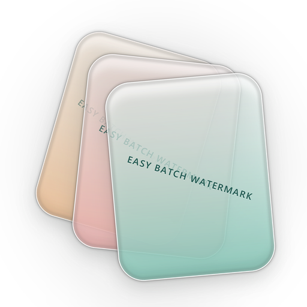

  

<h1 align="center">Easy Batch Watermark · 万物可印</h1>

<b>给图片、GIF、PDF、视频批量加水印。纯本地运行，文件不上传。</b>

简体中文 ｜ <a href="README.en.md">English</a>

  
  
  
  

日常要给大量文件打水印？Easy Batch Watermark 用一个本地工具，把各种格式文件的批量水印一次做完。

- **一个工具，多种格式**：图片 / GIF / PDF / 视频等统一批量处理，不再来回换软件
- **真·批量**：一次导入多个文件，统一设置水印位置、样式和透明度
- **纯本地，隐私可控**：不上传、不需要账号，敏感合同和未公开素材也能放心处理
- **开源可审计**：代码公开，本地行为可验证

> 如果你不能把文件上传到网上，这就是为你做的批量水印工具。

**支持格式**：图片 16 种（JPG · PNG · WebP · HEIC · AVIF · TIFF · BMP · JP2 · ICO · SVG · GIF 等）、PDF、视频 12 种（MP4 · MOV · MKV · AVI · WebM · FLV · WMV · MPEG · TS · M2TS 等）—— 完整清单见下方「支持格式」，持续增加中。

适合摄影师、电商运营、设计师、法务/行政，以及任何需要批量处理文件且在意隐私的人。

## 能做什么

- **文字水印**：字号按图片短边自适应，颜色、透明度、旋转、九宫格或自定义坐标
- **Logo 水印**：缩放、透明度、旋转，可与文字水印叠加（先文字后图片）
- **平铺与错位**：整图铺满，行间可错位；间距按"看得见的边缘"计算，不留透明缝
- **预览即导出**：水印可直接拖到想放的位置，导出的就是你看到的样子
- **批量与预设**：一次导入一批，参数存成预设反复用；支持只给某个文件、某一页单独设参数
- **PDF 逐页**：覆盖层叠加，原文可选可搜；支持逐页不同参数、合并成多页 PDF
- **视频**：与图片同一套几何算法；CRF 16 视觉无损，10bit / HDR 保留，音轨直通
- **输出**：同格式 / PNG / JPEG / WebP / TIFF / HEIC / PDF，可整批合并成一个多页 PDF

## 下载

| 方式 | 说明 |
|------|------|
| [下载最新版](https://github.com/MilanDeShallow/EasyBatchWatermark/releases/latest) | `WatermarkTool-vX.Y.Z.zip`，解压即用，无需安装 Python 或任何依赖 |

> 解压后请保持 `WatermarkTool` 文件夹完整 —— exe 与同目录的 `_internal` 是一体的，单独把 exe 拷出来无法运行。
> 压缩包约 130MB（自带 ffmpeg，离线可用）。程序不自动升级，换新版请重新下载覆盖。

## 三步上手

1. 解压压缩包，双击 `万物可印.exe`
2. 把文件拖进窗口（图片、GIF、PDF、视频可以混着拖）
3. 调好水印，点「开始处理」

## 支持格式

| 类型 | 输入 | 输出 |
|------|------|------|
| 图片（16 种） | `.jpg` `.jpeg` `.png` `.bmp` `.webp` `.tiff` `.tif` `.heic` `.heif` `.avif` `.avifs` `.jp2` `.j2k` `.ico` `.svg` `.gif` | 同格式，或转 PNG / JPEG / WebP / TIFF / HEIC / AVIF / JP2 / PDF |
| PDF | `.pdf` | `.pdf`（逐页叠加，原内容与文字层保留） |
| 视频（12 种） | `.mp4` `.m4v` `.mov` `.mkv` `.avi` `.webm` `.flv` `.wmv` `.mpg` `.mpeg` `.ts` `.m2ts` | `.mp4`（默认）或源容器；编码 H.264 / 源编码器 |

三种源可以混在同一批里处理。几点说明：GIF 取首帧处理（本工具是静态合成管线）；SVG 会先光栅化再加水印；ICO 保留原容器格式。视频功能自带 ffmpeg，不需要你另外安装。

## 常见问题

<b>会上传我的文件吗？</b>

不会。所有处理都在本机完成，程序不联网、不需要账号，除了你主动打开下载页面，没有任何网络请求。

<b>处理完会改我的原图吗？</b>

默认不会。输出默认写到源文件旁的 <code>watermarked_output/</code>，同名文件自动重命名、绝不覆盖。只有你主动勾选「覆盖原图」才会就地改写，该操作需要两次确认且不可撤销。

<b>PDF 加水印后还能选中、复制文字吗？</b>

能。水印以覆盖层形式叠加，原页面内容与文字层完整保留，可正常选中、复制与搜索。

<b>视频会掉画质吗？</b>

默认 CRF 16 + preset slow（视觉无损档），实测 1080p 纯重编码 SSIM 0.999；10bit 源输出 10bit，HDR 保留色彩标记，音轨原样直通。

<b>处理失败了去哪看原因？</b>

输出目录会生成 <code>失败清单_YYYYMMDD_HHMMSS.txt</code>，完成对话框里也有「查看失败清单」按钮；更详细的堆栈在 <code>%APPDATA%\WatermarkTool\app.log</code>。

<b>能写脚本批量调用吗？</b>

可以。引擎与界面完全解耦，同一个 <code>WatermarkConfig</code> 既能给 GUI 用也能给脚本用，见 <a href="docs/api.md">docs/api.md</a>。

## 文档

- [配置参数详解](docs/parameters.md)：所有字段、默认值、九宫格取值、输出目录规则、预设系统
- [脚本与 API](docs/api.md)：命令行、图片 / PDF 引擎、三层参数作用域、批处理
- [从源码运行与实现](docs/development.md)：环境要求、打包、技术设计、项目结构、测试

## 许可证

本项目采用 [MIT License](LICENSE)。

第三方组件：Pillow、customtkinter、tkinterdnd2、reportlab、pypdf、pypdfium2、psutil（均为宽松许可，与本项目兼容）。

视频水印使用 **FFmpeg（GPL-3.0）**，以独立可执行文件形式随 Windows 分发包提供（不静态链接、未做修改）。其源码可从 <https://ffmpeg.org/download.html> 获取，本项目使用的构建见 <https://www.gyan.dev/ffmpeg/builds/>。
